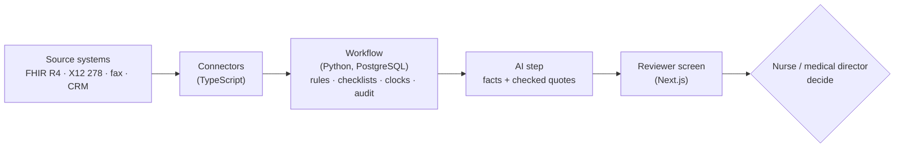

# prior-auth-workbench

**A prior-authorization request arrives from any of four source systems, gets checked against the health plan's documentation rules, has its key facts pulled out of the clinical notes with quotes as proof, and lands in a queue where people decide, on the clock CMS sets.**

> Personal learning project. Tallowmere Health Plan, every member, provider, request and note here is made up. The AI gathers and drafts; it never approves or denies. Nothing here is medical policy or a claim of HIPAA or Da Vinci conformance.

## Why

Prior authorization is where health plans spend a lot of skilled time on paperwork:
- Requests arrive by fax, portal, phone and X12 278, and get re-keyed.
- Many are incomplete, so the provider is chased for documents one at a time.
- Nurses read long packets to find the few facts a checklist needs.

Since 2026, the CMS Interoperability and Prior Authorization rule (CMS-0057-F) also requires impacted payers to decide within 72 hours for expedited requests and 7 days for standard ones, give reasons for denials, and publish their numbers every year.

The interesting part isn't an AI that reads documents. It's everything around it:
- connecting messy systems
- making the rules explicit
- keeping people in charge of decisions
- proving every fact with a quote
- running reliably

## The plan

| Stage | Steps | Status |
|---|---|---|
| A. Discovery | 1. Discovery pack | ✅ Done |
| B. Core workflow | 2. Rules and validation · 3. Case lifecycle, audit, clocks · 4. Sign-in and permissions · 5. Reviewer screen | In progress |
| C. Integrations | 6. Connector service and FHIR · 7. X12 278, fax and CRM · 8. Reliability | |
| D. Bounded AI | 9. Labelled test set · 10. Extraction with checked quotes · 11. Reviewer summary | |
| E. Operate | 12. Containers and CI · 13. Deploy, rollback and outage drills | |
| F. Outcome | 14. Measure · 15. Business case and demo | |

## Discovery pack

Start here: [`docs/discovery`](docs/discovery/README.md). It covers:
- the problem, and the current and future process
- stakeholders and who decides what
- numbered requirements and acceptance scenarios
- scope and non-goals
- a primer on FHIR, Da Vinci, X12, NCPDP, C-CDA and CMS-0057-F
- a plan for the first client workshop

The first design decision is already written down: [the AI gathers and drafts, people decide](docs/decisions/0001-ai-gathers-humans-decide.md).

## Build log

Each step records what I built, what broke or surprised me, and what I learned. I'm pairing with Claude Code on this project; the commit history shows it.

### Step 1: discovery before code

**Built:** a discovery pack for a fictional health plan, before writing any code:
- problem statement, current and future process maps
- stakeholder map with who decides what
- 21 functional and 12 non-functional requirements, each tagged with the step that delivers it
- 14 acceptance scenarios that later steps will turn into tests
- scope and non-goals, a standards primer, and a first-workshop plan

**Decision:** the AI never approves, denies or changes a case's state. It extracts facts with quotes and drafts summaries; anything it can't back with a quote goes to a person. Written down as decision record 0001 so later steps can be held to it.

**What surprised me:** the two biggest delays in the current process probably don't need AI at all:
- Missing documents are requested one at a time.
- The queue is first-in-first-out instead of sorted by deadline.

An explicit checklist and a deadline-aware queue are the quick wins. AI fact extraction is the structural change that comes after.

**Learned:** the standards each answer a different question:
- **FHIR** is how clinical context gets pulled from EHRs.
- **X12 278** is still the HIPAA-named transaction most electronic requests use.
- **NCPDP** covers drugs, which sit outside this rule.
- **C-CDA** is how many EHRs package notes.

The Da Vinci guides split the FHIR route into three questions:
- **CRD:** is authorization needed?
- **DTR:** what documentation?
- **PAS:** submit and answer.

The workflow here uses the same split, without claiming conformance.

### Step 2: rules and validation

**Built:** the service catalogue as a versioned YAML file ([`workflow/rules/catalogue.yaml`](workflow/rules/catalogue.yaml)): which services need authorization, and the documents each one needs. Format checks for everything a request carries: synthetic member IDs, provider NPI, CPT/HCPCS service codes, ICD-10-CM diagnoses and date order. A coverage check for "covered on the service date". Every problem comes back at once, with a message a coordinator can act on. 39 tests, no database needed yet.

**Decision:** the rules are data, not code. The people who own them (clinical policy) change a reviewed file, and each case will record the catalogue version it was checked against. A malformed catalogue stops the service at startup instead of failing halfway through a request.

**Learned:** an NPI's last digit is a Luhn check digit computed with a fixed `80840` prefix, which works out to adding 24 before the usual Luhn sum. CMS's worked example (`123456789` → check digit `3`) is now a test.

## License

[MIT](LICENSE)
