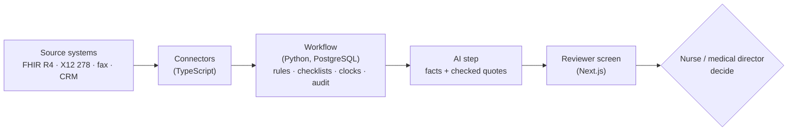
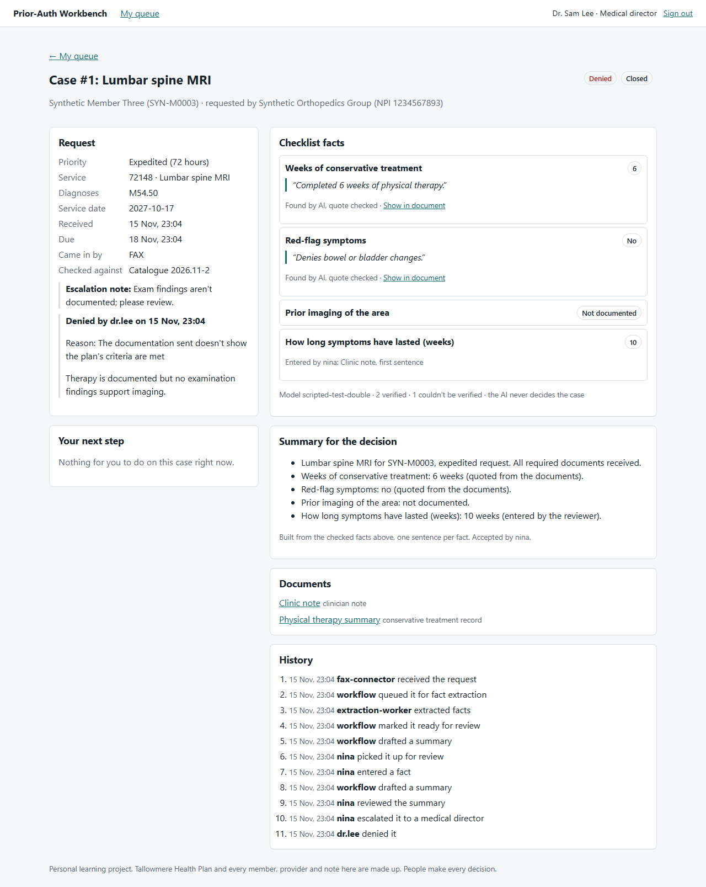
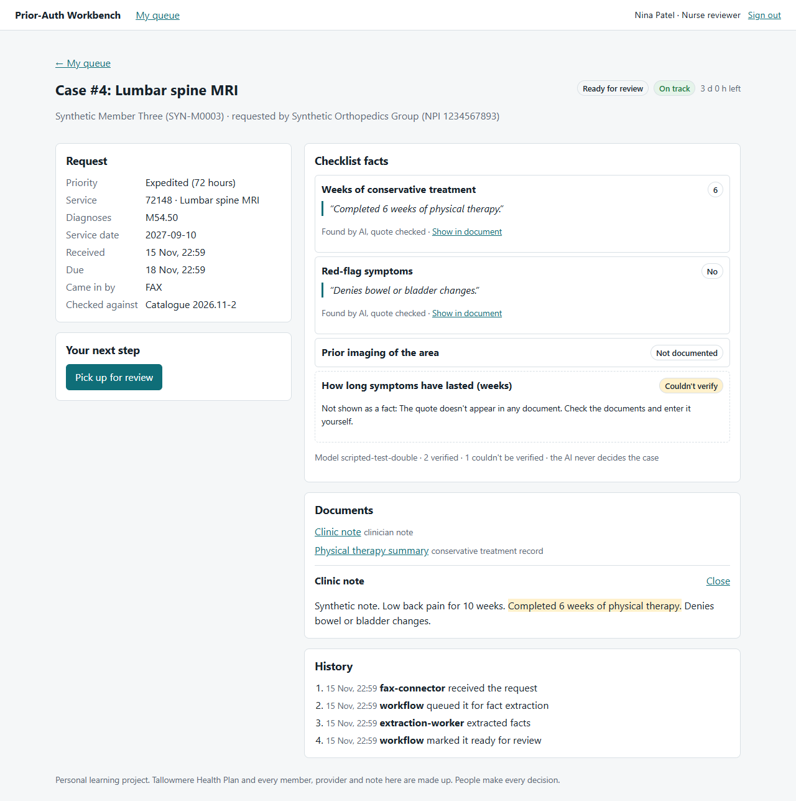
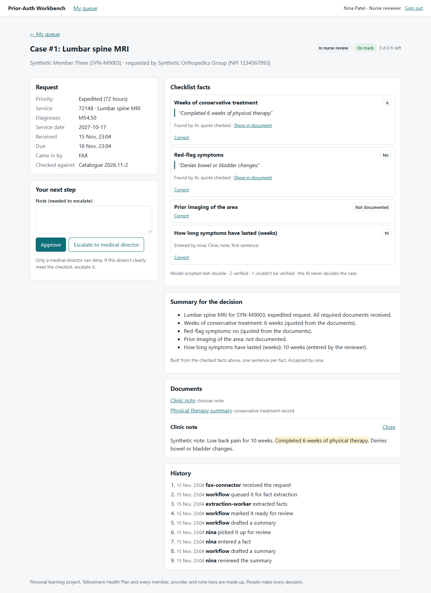

# prior-auth-workbench

**A prior-authorization request arrives from any of four source systems, gets checked against the health plan's documentation rules, has its key facts pulled out of the clinical notes with quotes as proof, and lands in a queue where people decide, on the clock CMS sets.**

> Personal learning project. Tallowmere Health Plan, every member, provider, request and note here is made up. The AI gathers and drafts; it never approves or denies. Nothing here is medical policy or a claim of HIPAA or Da Vinci conformance.

## Why

Prior authorization is where health plans spend a lot of skilled time on paperwork:
- Requests arrive by fax, portal, phone and X12 278, and get re-keyed.
- Many are incomplete, so the provider is chased for documents one at a time.
- Nurses read long packets to find the few facts a checklist needs.

Since 2026, the CMS Interoperability and Prior Authorization rule (CMS-0057-F) also requires impacted payers to decide within 72 hours for expedited requests and 7 days for standard ones, give reasons for denials, and publish their numbers every year.

The interesting part isn't an AI that reads documents. It's everything around it:
- connecting messy systems
- making the rules explicit
- keeping people in charge of decisions
- proving every fact with a quote
- running reliably

## The plan

| Stage | Steps | Status |
|---|---|---|
| A. Discovery | 1. Discovery pack | ✅ Done |
| B. Core workflow | 2. Rules and validation · 3. Case lifecycle, audit, clocks · 4. Sign-in and permissions · 5. Reviewer screen | ✅ Done |
| C. Integrations | 6. Connector service and FHIR · 7. X12 278, fax and CRM · 8. Reliability | ✅ Done |
| D. Bounded AI | 9. Labelled test set · 10. Extraction with checked quotes · 11. Reviewer summary | ✅ Done |
| E. Operate | 12. Containers and CI · 13. Deploy, rollback and outage drills | In progress |
| F. Outcome | 14. Measure · 15. Business case and demo | |

## Discovery pack

Start here: [`docs/discovery`](docs/discovery/README.md). It covers:
- the problem, and the current and future process
- stakeholders and who decides what
- numbered requirements and acceptance scenarios
- scope and non-goals
- a primer on FHIR, Da Vinci, X12, NCPDP, C-CDA and CMS-0057-F
- a plan for the first client workshop

The first design decision is already written down: [the AI gathers and drafts, people decide](docs/decisions/0001-ai-gathers-humans-decide.md).

## Build log

Each step records what I built, what broke or surprised me, and what I learned. I'm pairing with Claude Code on this project; the commit history shows it.

### Step 1: discovery before code

**Built:** a discovery pack for a fictional health plan, before writing any code:
- problem statement, current and future process maps
- stakeholder map with who decides what
- 21 functional and 12 non-functional requirements, each tagged with the step that delivers it
- 14 acceptance scenarios that later steps will turn into tests
- scope and non-goals, a standards primer, and a first-workshop plan

**Decision:** the AI never approves, denies or changes a case's state. It extracts facts with quotes and drafts summaries; anything it can't back with a quote goes to a person. Written down as decision record 0001 so later steps can be held to it.

**What surprised me:** the two biggest delays in the current process probably don't need AI at all:
- Missing documents are requested one at a time.
- The queue is first-in-first-out instead of sorted by deadline.

An explicit checklist and a deadline-aware queue are the quick wins. AI fact extraction is the structural change that comes after.

**Learned:** the standards each answer a different question:
- **FHIR** is how clinical context gets pulled from EHRs.
- **X12 278** is still the HIPAA-named transaction most electronic requests use.
- **NCPDP** covers drugs, which sit outside this rule.
- **C-CDA** is how many EHRs package notes.

The Da Vinci guides split the FHIR route into three questions:
- **CRD:** is authorization needed?
- **DTR:** what documentation?
- **PAS:** submit and answer.

The workflow here uses the same split, without claiming conformance.

### Step 2: rules and validation

**Built:** the service catalogue as a versioned YAML file ([`workflow/rules/catalogue.yaml`](workflow/rules/catalogue.yaml)): which services need authorization, and the documents each one needs. Format checks for everything a request carries: synthetic member IDs, provider NPI, CPT/HCPCS service codes, ICD-10-CM diagnoses and date order. A coverage check for "covered on the service date". Every problem comes back at once, with a message a coordinator can act on. 39 tests, no database needed yet.

**Decision:** the rules are data, not code. The people who own them (clinical policy) change a reviewed file, and each case will record the catalogue version it was checked against. A malformed catalogue stops the service at startup instead of failing halfway through a request.

**Learned:** an NPI's last digit is a Luhn check digit computed with a fixed `80840` prefix, which works out to adding 24 before the usual Luhn sum. CMS's worked example (`123456789` → check digit `3`) is now a test.

### Step 3: case lifecycle, audit trail and deadline clocks

**Built:** the workflow service (FastAPI + PostgreSQL):
- Intake takes one request in the internal format and routes it: closed when the member isn't covered on the service date, closed when the service needs no authorization, pended with one request listing every missing document, or ready for review.
- New documents re-run the checks.
- Each case gets a 72-hour or 7-day clock from receipt, and the queue is sorted by deadline.
- A role-and-state table says who may start a review, approve, escalate, deny or withdraw.
- Every change goes into an audit trail the database won't let anyone edit, carrying the caller's trace ID and no note text.

Acceptance scenarios AS-01 to AS-07, AS-10 to AS-12 are now tests. 90 tests in all.

**What broke:**
- **The race test was fake.** My first test for "two channels send the same request at the same moment" passed even with the lock removed. Each thread opened its database connection after the start signal, so they ran one after another. Now each thread connects first. Without the lock, the database's own rule (one open case per member, provider, service and date) rejects the second insert with a unique-key error. With the lock, all four arrive together and exactly one case opens, every time.
- **Loading the synthetic members failed** on a foreign key: SQLAlchemy saved coverage rows before the members they point to, because no relationship links the two models. The members are now saved first.

**Decisions:**
- **The clock keeps running while a case waits for documents.** Whether a request for information may pause it depends on the plan's own policies, an open question in the discovery pack, so the safe default is a clock that never pauses.
- **Coverage problems close the case,** never deny it. An ineligible member isn't a medical-necessity decision.
- **A denial can't be saved without a reason code and an explanation.** That's checked in the API and again by a database constraint.

### Step 4: sign-in and permissions

**Built:**
- **Sign-in for people:** scrypt password hashes, an 8-hour signed session cookie (HttpOnly, SameSite=Strict), a 15-minute lockout after five wrong passwords, and a custom header on every cookie request that changes something.
- **API tokens for the two services.** The connectors may only send requests; the extraction worker may only write extraction results.
- **Decision endpoints** for start review, approve, escalate, deny and withdraw, all running through the role-and-state table from Step 3.
- **Queues per person,** and admin-only user management.

AS-10 and AS-11 now also run over HTTP. 112 tests.

**What broke:**
- **Sessions expiring in tests.** The deadline tests move the clock forward 59 and 72 hours, and the nurse's session expired on the way. That's correct behaviour, so the test now signs in again after each jump.
- **Slow tests.** Hashing five demo passwords before every test took the suite to 42 seconds. The users are now created once per run and reset between tests: 18 seconds.

**Decisions:**
- **No one-off sign-in for the real world.** For a real client, the password sign-in gets replaced by their identity provider, and the role checks stay as they are ([decision record 0002](docs/decisions/0002-sign-in.md)).
- **"No such case" for cases you can't see.** A case someone isn't allowed to see answers the same as one that doesn't exist, so case numbers don't leak.
- **Services can never decide.** Neither service role appears in any decision's allowed list. A test calls every decision endpoint with the extraction worker's token and expects 403 each time.

### Step 5: reviewer screen

**Built:** the Next.js reviewer screen:
- **Sign-in** page.
- **A queue for each person,** sorted by deadline, with risk badges and expedited tags.
- **A case page** with the request, missing documents, documents to read, history and "your next step". It only shows the buttons this person may use right now.
- **User management** for admins.

The browser only talks to Next.js, which passes `/api/*` on to the workflow service. That keeps the session cookie first-party, with no CORS setup.

**Tested:** two Playwright tests:
- **The full journey:** intake sees exactly what's missing; a nurse reads a document, picks the case up and escalates it; the medical director is refused a denial without a reason code, then denies with one, and the history shows every step.
- **The server's own refusal:** a nurse calling the deny endpoint directly gets a 403.

**What broke:** checking for the error message by its `alert` role found two elements: my message, and Next.js's own hidden route announcer, which also has `role="alert"`. The test now picks the alert that contains the message.

### Step 6: connector service and FHIR R4

**Built:**
- **The connector service in TypeScript.** It runs on Node's built-in TypeScript support, so there's no build step; `tsc` only type-checks.
- **One internal request format** (`connectors/src/canonical.ts`), mirroring the workflow's schema, with the same NPI, code and member-ID checks, so obviously bad records stop before they're sent.
- **A FHIR R4 adapter.** It reads a bundle's Patient, Coverage, Practitioner, ServiceRequest and DocumentReference resources:
  - **Member ID** from the plan's identifier system, **NPI** from `us-npi`.
  - **Codes:** CPT/HCPCS from the order code, ICD-10-CM from its reason codes.
  - **Priority:** `urgent`, `asap` or `stat` become expedited.
  - **Documents:** plain-text attachments become documents, with LOINC 11506-3 (Progress note) mapped to a clinician note.
- **A pipeline and CLI:** parse, check, send, one JSON log line per message, with IDs and never names or note text.

**Tested:** 11 connector tests. Also run by hand against the real workflow service: the two synthetic bundles became one case ready for review and one pended for its missing sleep questionnaire. Sending them again came back as harmless replays.

**Decision:** a mapping, not a validator. The adapter takes exactly the fields the workflow needs and lists every problem it finds. It makes no claim of FHIR or Da Vinci conformance.

### Step 7: X12 278, fax and CRM adapters

**Built:** three more adapters, each with hand-built synthetic fixtures:
- **X12 278 request** (`005010X217`): a narrow parser.
  - It reads the element, component and segment separators from the fixed-width ISA header instead of assuming `*`, `:` and `~`.
  - It checks the segment count in SE01.
  - It walks the hierarchical levels for the requester (NPI with qualifier XX), the member (MI), diagnoses (`HI` with ABK/ABF) and the service date (`DTP*472`). The service code comes from `SV1`/`SV2`.
- **Fax index:** a CSV row per fax (with a small quote-aware CSV reader) pointing at the faxed documents' text.
- **CRM:** case records from the portal or call center.

**What it does end to end:** one `ingest` run over all ten fixtures, against the real workflow service:
- 9 delivered, 1 rejected.
- **The 278 for the same request as a FHIR order linked** to the existing case instead of opening a new one.
- **A later fax carrying only the missing sleep questionnaire** linked to its pended case and moved it to ready for review.
- **The 278 with a bad NPI check digit** never left the connector.
- **The CRM office visit** closed as "no authorization needed".
- **The fax for a member whose coverage ended** closed as "not eligible".

22 connector tests.

**What broke:**
- **A wrong count in my own test.** I expected 16 segments in the transaction; ST to SE is 15. The parser was right.
- **A Windows path quirk.** The fax test built its fixture path from `new URL(...).pathname`, which keeps `%20` for the space in my folder name. It found no files. `fileURLToPath` fixes it.

**Open question, written down:** how a clearinghouse flags an expedited 278 depends on its companion guide, which this project doesn't have. X12 requests arrive as standard until that's confirmed.

### Step 8: reliability

**Built:**
- **Retries** for network errors, timeouts, 408, 429 and 5xx, with exponential backoff, jitter and a 30-second cap. `Retry-After` is honoured.
- **A timeout** on every attempt.
- **Nothing dropped:**
  - After the last attempt, a record is **parked** with its reason.
  - A 422 is **rejected** at once and kept for a person to fix.
  - A refused token or a wrong URL parks at once instead of hammering the service.
- **An outbox** (`out/parked`, `out/rejected`), one JSON file per message with the original kept, plus `replay` and `status` commands.

Replays are safe because the workflow service treats (source, source_id) as one message.

**Tested:** 8 failure tests against a real local HTTP server that misbehaves on purpose:
- 503 twice, then success.
- Timeouts until parked, then a replay after recovery that creates exactly one case (AS-13).
- 429 with `Retry-After`.
- 422, 401, and a service that isn't there at all.
- A bad-NPI 278 rejected, fixed at the source and replayed (AS-07).

30 connector tests.

**Drill against the real service:**
- **Stopped:** I stopped the workflow service and sent a new CRM request. It was parked after three attempts, and the command exited with code 1 so a scheduler would notice.
- **Restarted:** `replay` created the case and emptied the outbox.
- **Sent again:** the same message came back as a harmless replay.

**Changed my mind:** fax messages were identified by their row number in the index. A corrected index can move rows, so replay matches them by fax ID instead.

### Step 9: a labelled test set before any AI

**Built:**
- **The test set:** 40 synthetic clinical notes with the correct answers written down ([`workflow/eval`](workflow/eval/README.md)), 25 for lumbar spine MRI and 15 for sleep studies, generated from sentence templates so the labels can't drift from the text. It includes traps:
  - a negation next to a red flag
  - an MRI mentioned only in the plan
  - last year's score next to today's
  - "no one has witnessed", which means unknown, not no
- **The verifier the app will use on every extracted fact:** the quote must appear in a document, numbers must appear in their quote, values must have the right type.
- **A scoring script** that reports false fills (a value where the note says nothing) separately, because that's the most dangerous error.
- **A rule-based baseline** to beat.

**Result:** the rules baseline gets 110 of 145 answers right (75.9%), with 10 false fills.

**What broke:** the baseline exposed a bug in my verifier. "Has not tried physical therapy" means 0 weeks, but the rule "the number must appear in its quote" dropped every correct zero. Zero now passes when the quote says something wasn't done.

**Decision:** the test set and scoring come before the model. Without them, "the AI is accurate" would only be an impression. The Claude row in the results table stays empty until it's actually run.

### Step 10: extraction with checked quotes

*The answers in this screenshot were sent by the browser test acting as the worker (shown as `scripted-test-double`), not by a live model run.*

**Built:**
- **A Claude extractor** (Claude Opus 5.5):
  - one request per case
  - structured JSON output against a strict schema
  - low effort
  - server-side refusal fallback
  - instructions marked for caching
  - every API error mapped to "unavailable"
- **An extraction worker** (`python -m app.worker`) that holds only the extractor token. It can claim cases waiting for extraction and send back raw answers, nothing else.
- **On the workflow side:** every answer is checked against the documents before a reviewer sees it. Each fact is stored as verified, not documented, or couldn't verify, with the run's tokens and cost.
- **On the reviewer screen:** each fact sits next to its quote, with **Show in document** highlighting it. Unverified answers are marked as such, never shown as facts.
- **A manual GitHub workflow** to score Claude on the test set once a key exists.

AS-08 (a made-up quote is dropped) and AS-09 (AI failure or silence goes to manual entry) are now tests. 146 workflow tests.

**What broke:** the worker's answers came back 422. FastAPI matched `/api/cases/{id}/extraction` to the generic `/api/cases/{id}/{action}` route first, which only accepts decision names. The worker now has its own path, `/api/extraction/{case_id}`.

**Decisions** ([decision record 0003](docs/decisions/0003-ai-extraction.md)):
- **The worker is a separate, least-privileged process** whose answers are never trusted.
- **Intake never waits on the AI:**
  - a failed answer goes to manual entry
  - a worker that goes silent is overtaken by a 10-minute sweep
  - each claim is leased for 5 minutes so a crashed worker's cases are picked up again
- **No citations feature.** Claude's citations can't be combined with structured output, so our own verifier checks the quotes.

**Not done yet:** a live Claude run on the test set. This project has no API key, so the results table says "not run yet" rather than showing an estimate.

### Step 11: reviewer summary, fact entry and correction

**Built:**
- **A summary for the decision,** drafted whenever a case reaches review: one sentence per checked fact, each carrying the ID of the fact it came from, plus a plain warning when answers couldn't be verified.
- **The reviewer can:**
  - enter a missing fact or correct an extracted one, saying where in the documents it comes from
  - accept the summary or edit it

  Every change is attributed and audited. The AI's original answer is kept, marked superseded, so corrections can be counted later.
- **A one-page "[where AI is and isn't allowed](docs/ai-use.md)"** for compliance and IT: each step, who does it, and how that's enforced.

155 workflow tests. The browser test now also enters the fact the AI couldn't verify and accepts the summary.

**Decision** ([decision record 0004](docs/decisions/0004-summary-and-review.md)): the summary is built by template from the checked facts, not written by the model. The facts are already structured, so a model rewriting them would add the exact risk this design exists to prevent (a sentence the facts don't support) without adding information.

**What broke:** nothing new. Two older tests had to learn that the history now ends with "summary drafted".

### Step 12: containers, logs, metrics and CI

**Built:**
- **Container images** for the workflow service (which is also the extraction worker, with a different command), the web app (Next.js standalone) and the connectors. Pinned bases, numeric non-root users.
- **`compose.yaml`:** the whole system with one command, with the connectors as a one-off job.
- **JSON request logs** with the trace ID, and never patient details.
- **A Prometheus `/metrics` endpoint:**
  - requests by route pattern
  - live counts of cases by state and deadline risk
  - extraction outcomes
  - facts by source
  - summary reviews
- **Demo seeding behind an advisory lock,** because two copies starting together would otherwise race on the demo users, the same lesson as the schema race in serviceops-workbench.
- **CI on every push:**
  - the workflow tests on PostgreSQL
  - the rules baseline score
  - connector tests and type-check
  - the browser tests
  - then the images job, which builds every image and runs the system from them
- **What the images job checks:**
  - all 10 fixtures go through the real connectors (expecting 9 delivered, 1 refused)
  - a smoke test where the real extraction worker fills in verified facts
  - an **AI outage drill**: with the worker stopped, a new case must still reach a nurse, with facts marked for manual entry

**Checked locally:** actionlint, shellcheck, `docker compose config` and 158 workflow tests. Docker can't run on my machine, so everything that needs containers runs in GitHub Actions. The first results go in the next entry.

## License

[MIT](LICENSE)
