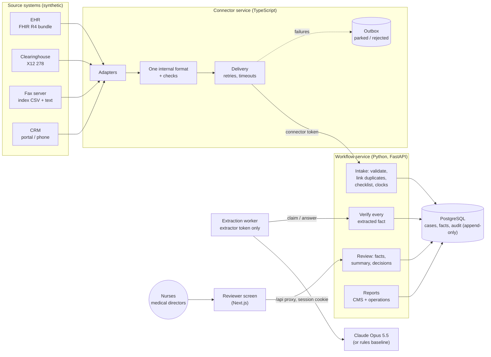

# Architecture

## Trust boundaries

| From → to | How it's authenticated | What it may do |
|---|---|---|
| Connector → workflow | API token (`CONNECTOR_TOKEN`) | Send requests and documents. Nothing else |
| Extraction worker → workflow | API token (`EXTRACTOR_TOKEN`) | Claim cases waiting for extraction; send raw answers. No queues, no state changes, no decisions |
| Extraction worker → model provider | Provider API key | Synthetic notes only in this project. PHI only under a BAA in a real deployment |
| Browser → web app → workflow | Signed HttpOnly session cookie through the same-origin proxy; `X-Requested-With` on changes | Whatever the person's role allows ([decision 0002](decisions/0002-sign-in.md)) |
| Workflow → database | Database credentials from a Kubernetes Secret | The audit table refuses UPDATE and DELETE |

## Where each rule lives

| Rule | Where |
|---|---|
| What needs authorization; what documents each service needs | [`workflow/rules/catalogue.yaml`](../workflow/rules/catalogue.yaml) (versioned data) |
| Format checks (NPI, codes, member IDs) | [`workflow/app/validation.py`](../workflow/app/validation.py), mirrored in [`connectors/src/canonical.ts`](../connectors/src/canonical.ts) |
| Who may do what, from which state | [`workflow/app/lifecycle.py`](../workflow/app/lifecycle.py) (one table) |
| Deadlines | [`workflow/app/clocks.py`](../workflow/app/clocks.py) |
| What makes an extracted fact believable | [`workflow/app/extraction/verify.py`](../workflow/app/extraction/verify.py) |
| Rules the database enforces anyway | Decided cases have who and when; denials have a reason; one open case per request; verified facts have a quote; audit is append-only |

## Deployment

The same images run in compose (one machine) and Kubernetes (kind in CI). The workflow service runs as two replicas; the worker as one, with no Service, because nothing calls it; the web app as two. Probes: liveness doesn't check the database, readiness does. See [`deploy/`](../deploy) and the [runbook](operations/runbook.md).
