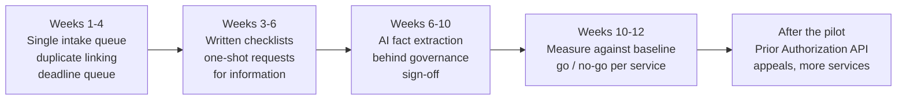

# Roadmap

Quick wins first: they don't depend on AI, and they fund the pilot. Each phase has an exit test, so "done" isn't a matter of opinion.

| Phase | Weeks | Delivers | Exit test | Depends on |
|---|---|---|---|---|
| 1. One front door | 1–4 | Connectors for fax index, CRM/portal and X12; duplicate linking; deadline-sorted queue; at-risk alerts | 95% of new requests arrive without re-keying; no duplicate cases in a two-week sample | IT access to the three feeds |
| 2. Ask once | 3–6 | Signed-off checklists for 3 services; one request listing everything missing | RFI rounds per case down from the measured baseline | Lead medical director's sign-off |
| 3. Facts with proof | 6–10 | Extraction worker on; facts with quotes; reviewer corrections tracked | Claude beats the rules baseline on the labelled set and on a two-week sample of real cases; false fills under an agreed limit | AI governance approval; BAA with the model provider |
| 4. Decide on evidence | 10–12 | Weekly report vs baseline; go / no-go per service | Sponsor signs off using the measures in the business case | Phases 1–3 |
| Later | After | FHIR Prior Authorization API (CMS, January 2027); appeals workflow; more services; SSO; backlog access mode ([decision 0005](../decisions/0005-backlog-access.md)) | Separate business cases | Payer-wide program |

## Quick wins vs structural change

- **Quick wins** (phases 1–2): change how work arrives and what gets asked, without changing who decides or how. Low risk, high certainty.
- **Structural** (phase 3 onward): change how reviewers spend their time, and give the plan a FHIR-ready core for the CMS API mandate. Higher value, needs governance and measurement.
