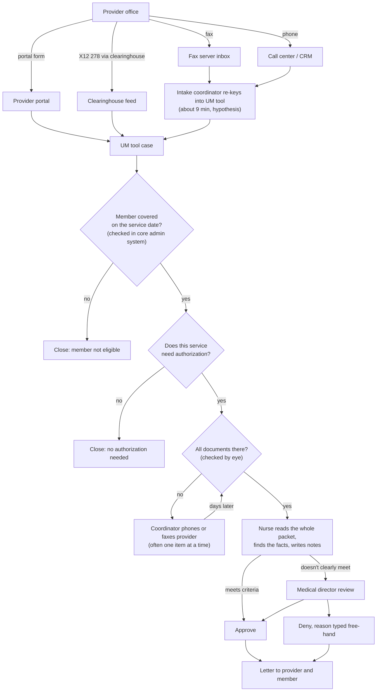

# 2. Current state: how a request moves today

> Fictional client. Steps and pain points are hypotheses to walk through with the people who do the work. A process map drawn without them is usually wrong in the places that matter.

## The map



## The people

| Role | What they do today | What frustrates them (hypothesis) |
|---|---|---|
| Intake coordinator | Opens cases, re-keys faxes and calls, checks eligibility, chases missing documents | Re-keying. Chasing the same provider several times. Duplicate faxes |
| Nurse reviewer | Reads the packet, applies the checklist, approves or escalates | Hunting for three facts in 40 pages. Cases arriving incomplete |
| Medical director | Reviews escalated cases, decides denials | Cases arriving without a clear summary. Writing denial reasons from scratch |
| UM supervisor | Balances queues, watches deadlines | No live view of which cases are close to the deadline |
| Provider office staff | Submits requests, answers RFIs | Being asked for documents one at a time. Not knowing status |

## The systems

| System | Holds | How we can reach it (to confirm with IT) |
|---|---|---|
| Core admin system | Members, coverage periods, providers, claims | Unknown: API, read replica or nightly file? |
| UM tool | Cases, notes, decisions | Vendor tool; export and API options unknown |
| Fax server and document store | Incoming faxes as PDFs | File drop plus an index CSV (common pattern) |
| Clearinghouse | X12 278 requests and responses | Batch files or real-time connection |
| CRM / call center | Member and provider calls | REST API (hypothesis) |
| Provider EHRs | Clinical notes, orders | Two large provider groups offer FHIR R4 access (hypothesis); others send faxes |

## Where the time goes (hypothesis, to measure in discovery)

```
Receipt ──► opened in UM tool ──► complete ──► nurse picks up ──► decision
   │  up to 1 working day  │  0–5 days (RFIs)  │  0.5–2 days queue  │  15–40 min reading
```

**The two biggest waits are probably:**
- **The RFI loop:** documents requested one at a time, over days.
- **The queue before a nurse:** first in, first out instead of by deadline.

Neither needs AI to fix. Both need the checklist to be explicit and the queue to know the deadline. That's why they're the quick wins in [the future state](03-future-state.md).

## What to bring back from the first site visit

1. **Ten real (de-identified) fax packets per pilot service.** These show the documents that actually arrive.
2. **The checklists reviewers really use,** written or unwritten. Sit with two nurses for an hour each.
3. **Last quarter's volumes by channel,** and the deadline misses if anyone tracks them.
4. **How eligibility is checked today,** and what IT will let a new system read.
5. **Three recent denial letters,** to see how reasons are written now.
