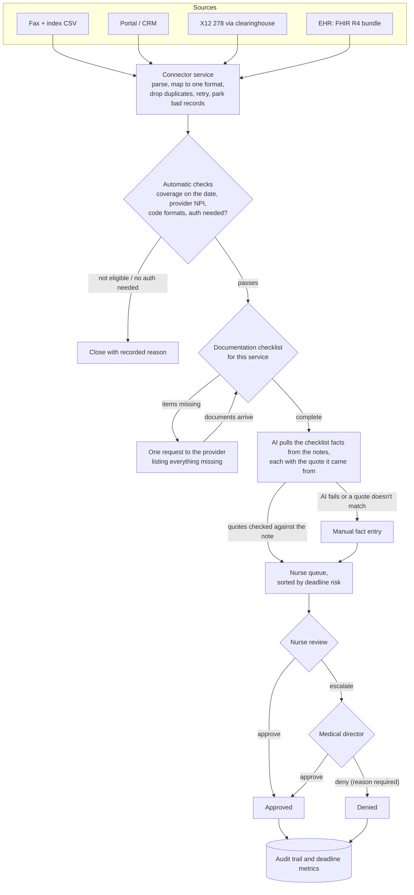
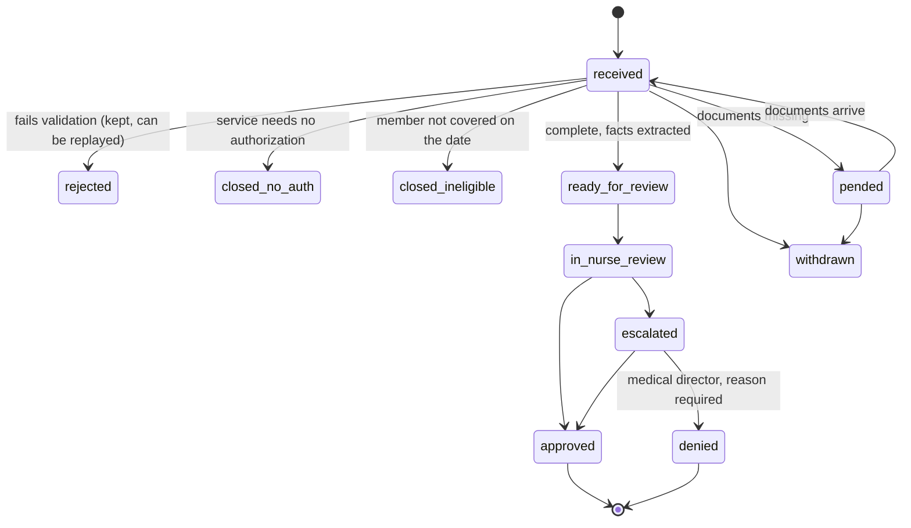

# 3. Future state: what changes, and what stays human

## The map

## The case states

## What changes

| Today | Future | Why it helps |
|---|---|---|
| Re-keying faxes and calls | One connector service turns every channel into the same record | Removes the slowest manual step and its typos |
| Missing documents asked for one at a time | The checklist lists everything missing in one request | Fewer RFI rounds |
| Nurses hunt through the packet | Facts laid out with the exact quote and where it came from | Faster review, and the nurse can check the source in one click |
| First in, first out | Queue sorted by time left before the 72-hour / 7-day deadline | Fewer missed deadlines |
| Duplicates open new cases | Same member, provider, service and dates link to the existing case | No double work |
| Free-hand denial reasons | Structured reason (code + explanation), required before a denial saves | Consistent, auditable reasons |

## What stays human, on purpose

- **Every coverage decision.** The AI never approves, denies or pends a case for clinical reasons. See [decision record 0001](../decisions/0001-ai-gathers-humans-decide.md).
- **Denials** are made only by a medical director, with a reason.
- **Checklist and rule changes** are made by named clinical owners, reviewed, and versioned.
- **Anything the AI can't back with a quote** goes to a person.

## Quick wins and structural changes

| | Change | Rough timing (pilot) | Depends on |
|---|---|---|---|
| Quick win | Single intake queue with duplicate linking | Weeks 1–4 | Fax index and portal export |
| Quick win | Checklist-driven RFI: everything missing in one request | Weeks 2–5 | Written checklists for 3 services |
| Quick win | Deadline-risk queue and supervisor view | Weeks 2–4 | Receipt timestamps from every channel |
| Structural | AI fact extraction with quotes | Months 2–3 | Labelled sample set, approved AI governance |
| Structural | X12 278 and FHIR intake without re-keying | Months 2–4 | Clearinghouse and provider-group access |
| Structural | CMS public metrics report from the case data | Month 3 | Clean decision and timestamp data |
| Later | Prior Authorization API readiness (CMS deadline January 2027) | After pilot | Payer-wide program |
